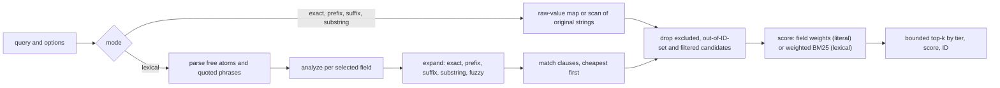

# Architecture: defuss-lexicalsearch

defuss-lexicalsearch is an in-memory lexical retrieval library. It analyzes caller documents per field, keeps postings and a vocabulary trie for each field, and ranks matches with field-weighted BM25 or with strict exact-first tiers. It does no vector search, language detection or persistence beyond JSON snapshots, and no network I/O except the explicit `fromURL` loader. A vector index can share its document IDs, so a separate fusion layer can merge both ranked lists. Usage is in the [README](README.md).

## Why this design

Fuzzy matching walks the field's code-point trie with one edit-distance row per prefix and stops at a prefix whose row minimum exceeds the radius. A BK-tree would be the usual alternative, but its pruning relies on the triangle inequality, which optimal string alignment violates: `CA` to `AC` costs 1, `AC` to `ABC` costs 1, yet `CA` to `ABC` costs 3. Metric pruning could therefore drop valid matches; row-minimum pruning cannot, because a transposition cell is at least the previous row's diagonal cell. Exhaustive tests compare Levenshtein and transposition matching with a full-matrix oracle, including deletions and supplementary Unicode (`test/oracles.test.mjs`, `test/lexical-oracles.test.mjs`).

Each field has its own analyzer, and a derived field analyzes another field's original string again. One shared token stream cannot keep `C++` apart from `C#` while still splitting `Array.prototype.map` into words; a raw keyword field plus a derived code-component field does both, and the input carries each string once.

Exact-first ranking compares a match tier before the score. BM25 alone ranks a rare typo above a common exact term because inverse document frequency rewards rarity; a test with 30 documents containing `fetch` and one containing `fatch` shows the typo first under relevance ranking and last under exact-first ranking (`test/lexical.test.mjs`). The cost is that scores need not decrease across tiers, so callers consume the returned order.

Snapshots store original documents, the field schema and analyzer IDs, never postings or functions. Restoring rebuilds every structure, which costs rebuild time on load but keeps snapshots free of executable code and lets a bug fix in derived structures apply to old snapshots.

## How it works

Indexing validates and copies a document, runs each configured field's analyzer over its own or its source field's string, then adds term positions to the field's postings, its vocabulary trie, a raw-value map for literal equality and the per-field BM25 statistics. `upsert` and `addAll` prepare everything before the first mutation, so a validation or analyzer error leaves the index unchanged.

A query takes one of two paths: literal modes compare original field strings, lexical mode analyzes and expands terms.

In lexical mode a free atom is a whitespace-delimited fragment; it matches a field only when all its analyzed components occur in that field. `operator: 'all'` requires every free atom, `'any'` at least one, and quoted phrases are always required and checked against positions in a single field. The planner orders required units by estimated posting cost, and each unit only probes the candidates the previous one left. When a query has exactly one active expansion, its posting list streams straight into the top-k heap.

Each field contributes `weight × idf × tf(k1 + 1) / (tf + k1(1 − b + b · length / average))` with `idf = log(1 + (N − df + 0.5) / (df + 0.5))`; `N`, `df` and the average length count only documents with a nonempty analyzed field. Alternatives of one query token in one field contribute once: the highest score, or under exact-first ranking the strongest match kind. Under exact-first ranking a candidate's tier is the weakest tier among its query clauses, raised to `literal` when a selected field's original string equals the query.

With `prefix` and `fuzzy` together, the fuzzy walk also carries the smallest distance from the query to any prefix on the path; once that is within the radius, every term below the node matches, so a typo in a partly typed word still completes. Prefix expansion walks the forward trie. Suffix expansion builds a reverse trie on first use, and substring expansion builds a trigram index on first use and verifies each candidate with `includes`; substrings shorter than three code points scan the vocabulary. Every later mutation keeps initialized structures current, and no expansion is capped.

Other code relies on these contracts: caller-owned stable string IDs; deterministic order by tier, score and ID across insertion orders; owned copies from `get` and in results; frozen metadata in filter callbacks; and an exception for any search or mutation started from inside a callback.

## Operations

- **Configuration and policy:** the constructor validates every option and fails fast: field weight in (0, 1,000,000], `b` in [0, 1], `k1` in [0, 1000], `maxDocuments` (default 100,000), `maxTokenLength` for indexed tokens (default 128, at most 4096). Per query it allows 16,384 UTF-16 units, 128 clauses, 128 analyzed tokens per field and 32 exclusion queries.
- **Deployment and scaling:** the package is published to npm as `defuss-lexicalsearch` and ships ESM, CommonJS and declarations built by pkgroll. pkgroll warns that the language entries mix named and default exports; both import styles are intended, and the e2e consumer uses both. `make e2e` installs the packed tarball in a clean consumer and runs it on Node.js 26, on bun 1.4 and in Chromium; `make test` runs the test suite on Node.js and on bun. All state lives in one process: memory grows with original strings, token sequences, postings and any initialized suffix or trigram index.
- **Complexity and resources:** exact terms visit only their postings. Broad terms, fuzzy radius 2, short substrings and literal prefix, suffix or substring modes can approach a scan of the vocabulary or the corpus, and the first suffix or substring query on a field pays for building its index. The API is synchronous; the Worker example keeps a browser main thread responsive. `make bench N=10000` writes timings and memory to `output/bench/`.
- **Website:** `docs/` is static and has no build step on the host, so GitHub Pages serves it as committed (custom domain in `docs/CNAME`). `make docs` copies the ESM build into `docs/assets/lib` and writes `docs/data/manifest.json`; `make e2e` does the same from the installed tarball and fails when a figure on the page differs from the manifest. The corpus ships gzipped and the worker unpacks it with `DecompressionStream`, because GitHub Pages sends `.gz` files without `Content-Encoding`.
- **Reliability:** invalid documents, options, snapshots or analyzer output throw before any mutation. This atomicity covers validation and callback errors, not process crashes or out-of-memory.
- **Observability:** the library does not log. `searchWithStats` returns expanded terms, postings visited and candidates scored; `stats()` returns per-field document and token counts.

## Security and privacy

The library processes caller-supplied documents and queries in memory. Query size and clause limits bound parsing work, but a broad or fuzzy query can still scan the corpus, so an application that accepts queries from untrusted users should bound the corpus and run search in a Worker. `fromJSON` validates format, schema, options and metadata and never evaluates code; analyzers are resolved by ID from the caller's registry. `fromURL` is the only network access: it accepts HTTP(S) URLs only, rejects non-success statuses, enforces `maxBytes` (default 64 MiB) on the declared length and while streaming, and decodes UTF-8 strictly. Authentication, CORS and timeouts come from the caller's `fetch` and `request` options. Metadata must be plain JSON, and prototype-like IDs, keys and terms are stored as ordinary data. The development server in `scripts/server.mjs` binds 127.0.0.1 and serves only `docs/`, `examples/` and the build directory. The website sends nothing anywhere: documents, notes and queries stay in the visitor's tab, its own code runs no analytics, sets no cookies and stores only the theme choice in `localStorage`. Its only third-party requests fetch defuss-shadcn's CSS and JavaScript from jsDelivr, pinned to version 0.9.11 with subresource integrity hashes, so a changed file fails to load instead of running.

The library processes no personal data on its own. It holds whatever the caller indexes, in memory and in snapshots the caller writes, and sends nothing anywhere. An application that indexes personal data owns its legal basis and retention, including `remove` for deletion requests and discarding old snapshots.
