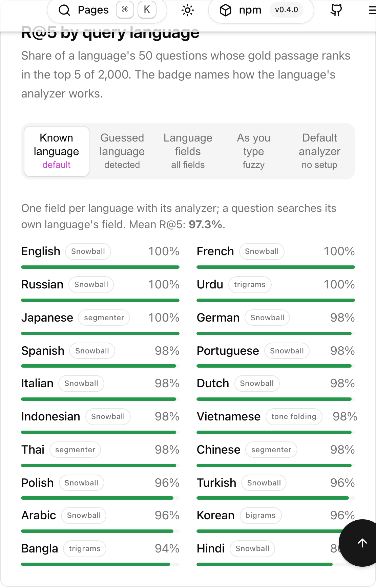

# defuss-lexicalsearch

[](https://www.npmjs.com/package/defuss-lexicalsearch)
[](https://www.npmjs.com/package/defuss-lexicalsearch)
[](https://www.npmjs.com/package/defuss-lexicalsearch)
[](https://bundlejs.com/?q=defuss-lexicalsearch)
[](LICENSE)

Full-text search for TypeScript and JavaScript apps, in the browser or Node.js: ranked, typo-tolerant search over your documents and exact matching for symbols such as `C++` or `Array.prototype.map`, in one in-memory index with zero runtime dependencies.

**Live demo and benchmarks: [lexicalsearch.defuss.org](https://lexicalsearch.defuss.org)**

## TL;DR

- **Ranked and exact in one index.** Field-weighted BM25 with an analyzer per field; exact-first ranking keeps an exact symbol above every partial match, although a word tokenizer reads both `C++` and `C#` as `c`.
- **Search as you type.** Completion, inside-word matching and typo tolerance, also inside the part typed so far: `Kül` finds `Kühlschrank`.
- **20 languages.** A stemmer, word segmentation or n-grams per language, measured below.
- **Literal modes.** `exact`, `prefix`, `suffix` and `substring` compare the original strings, case-sensitive by default.
- **Queries and filters.** Quoted phrases, AND and OR, exclusions, field restrictions, metadata and ID filters, and pagination.
- **Index lifecycle.** Atomic batch inserts and replacements, complete deletion, JSON snapshots and size-bounded loading from a URL.
- **Ships anywhere.** ESM and CommonJS with TypeScript declarations, and a module Worker example; indexing and search need no server and no network.

### Languages at a glance

Import a language's analyzer from `defuss-lexicalsearch/<entry>`. R@5 is the share of a language's 50 benchmark questions whose gold passage ranks in the top 5 of 2,000 passages; [Retrieval quality by language](#retrieval-quality-by-language) explains the benchmark.

<!-- languages:start -->
| Analysis | Entries | R@5, language known |
| --- | --- | ---: |
| Snowball stemming | `en` `de` `fr` `es` `pt` `it` `nl` `pl` `ru` `tr` `ar` `hi` `id` | 86–100% |
| Word segmentation | `th` `zh` `ja` | 98–100% |
| Syllable bigrams | `ko` | 96% |
| Words plus trigrams | `bn` `ur` | 94–100% |
| Tone mark folding | `vi` | 98% |

Mean R@5 over all 20 languages: **97.3%** when each question searches its language's field, **74.9%** with the default analyzer and no language setup.
<!-- languages:end -->

[](https://lexicalsearch.defuss.org/#recall)

## Quick start

Install the package from [npm](https://www.npmjs.com/package/defuss-lexicalsearch). Its `engines` field requires Node.js 26 or newer, and the tests also run it on bun 1.4.3:

```sh
npm install defuss-lexicalsearch
```

With bun, run `bun add defuss-lexicalsearch` instead.

A first search, with a typo in the query:

```ts
import { LexicalSearch } from 'defuss-lexicalsearch';

const index = new LexicalSearch({ fields: { title: { weight: 3 }, body: {} } });
index.addAll([
  { id: 'dialog', fields: { title: 'Dialog', body: 'A modal window for focused tasks.' } },
  { id: 'sheet', fields: { title: 'Sheet', body: 'A panel that slides in from the edge of the screen.' } },
]);

const hits = index.search('dialgo', { fuzzy: true, transpositions: true });
console.log(hits.map(hit => hit.id)); // [ 'dialog' ]
```

Each example on this page except the `fromURL` call, which needs a server, prints what its comments state; `test/readme.test.mjs` runs them against the built package, on Node.js and on bun.

## Usage

### Rank natural-language text

A language analyzer stems words, so `run` finds `Running` and `local` finds `locally`. `operator: 'all'` requires every query word, and `filter` checks each candidate's metadata:

```ts
import { LexicalSearch } from 'defuss-lexicalsearch';
import en from 'defuss-lexicalsearch/en';

const index = new LexicalSearch<{ category: string }>({
  analyzer: en,
  fields: { title: { weight: 3 }, body: {} },
});
index.addAll([
  { id: 'a', fields: { title: 'Running locally', body: 'A local search engine.' }, metadata: { category: 'guide' } },
  { id: 'b', fields: { title: 'Remote storage', body: 'Keep documents in a remote store.' }, metadata: { category: 'reference' } },
  { id: 'c', fields: { title: 'Local storage', body: 'Store documents locally.' }, metadata: { category: 'reference' } },
]);

console.log(index.search('run local').map(hit => hit.id)); // [ 'a', 'c' ]
console.log(index.search('run local', { operator: 'all' }).map(hit => hit.id)); // [ 'a' ]
console.log(index.search('local', { filter: metadata => metadata?.category === 'reference' }).map(hit => hit.id)); // [ 'c' ]
console.log(index.search('"remote store"').map(hit => hit.id)); // [ 'b' ]
```

Without an `analyzer` option, an index uses `unicodeAnalyzer`: NFKC normalization, lowercase, Unicode letters, digits and combining marks as words, and punctuation as a separator, with no stemming and no stopwords. It cannot tell `C++` from `C#`, because both analyze to `c`; the next section handles symbols.

### Search text in many languages

Give each language its own field with its analyzer, and restrict a query to the field of its language when the application knows it:

```ts
import { LexicalSearch } from 'defuss-lexicalsearch';
import ru from 'defuss-lexicalsearch/ru';
import ja from 'defuss-lexicalsearch/ja';

const index = new LexicalSearch({ fields: { ru: { analyzer: ru }, ja: { analyzer: ja } } });
index.addAll([
  { id: 'ru-1', fields: { ru: 'Мы читали книги в библиотеке.' } },
  { id: 'ja-1', fields: { ja: '東京の図書館で本を読んだ。' } },
]);

console.log(index.search('библиотека', { fields: ['ru'] }).map(hit => hit.id)); // [ 'ru-1' ]
console.log(index.search('図書館はどこ', { fields: ['ja'] }).map(hit => hit.id)); // [ 'ja-1' ]
console.log(index.search('図書館はどこ', { fields: ['ja'], operator: 'all' }).map(hit => hit.id)); // []
```

The Russian analyzer stems `библиотеке` and `библиотека` to one term. Japanese, Chinese and Thai write words without spaces, so their analyzers are `segmented`: the words of one unspaced query fragment count as separate words, and under the default OR one of them suffices. `operator: 'all'` requires every word, and `どこ` occurs in no document. Without `fields`, a query searches every language field; that needs no language detection but matches shared words across languages, which costs recall: compare the Known language and Language fields columns of the table below.

When the application can only guess the query's language, pass the guess as `language` instead of restricting `fields`. Each language entry names its language (`de.language` is `'de'`), and the fields of the guessed language weigh three times more, while every other field still matches, so a wrong guess costs little:

```ts
import { LexicalSearch } from 'defuss-lexicalsearch';
import de from 'defuss-lexicalsearch/de';
import en from 'defuss-lexicalsearch/en';

const index = new LexicalSearch({ fields: { de: { analyzer: de }, en: { analyzer: en } } });
index.addAll([
  { id: 'de-1', fields: { de: 'Pinguine im Zoo' } },
  { id: 'en-1', fields: { en: 'penguins at the zoo' } },
]);

console.log(index.search('zoo', { language: 'de' }).map(hit => hit.id)); // [ 'de-1', 'en-1' ]
console.log(index.search('zoo', { language: 'en' }).map(hit => hit.id)); // [ 'en-1', 'de-1' ]
console.log(index.search('Pinguine', { language: 'en' }).map(hit => hit.id)); // [ 'de-1' ]
```

A language identifier such as [defuss-lid](https://github.com/kyr0/defuss-lid) supplies the guess. This library does not depend on one, and its `major_20` pack covers the 20 language entries:

```ts
import { LexicalSearch } from 'defuss-lexicalsearch';
import de from 'defuss-lexicalsearch/de';
import en from 'defuss-lexicalsearch/en';
import { load } from 'defuss-lid/packs/major_20';

const index = new LexicalSearch({ fields: { de: { analyzer: de }, en: { analyzer: en } } });
index.addAll([
  { id: 'de-1', fields: { de: 'Pinguine im Zoo' } },
  { id: 'en-1', fields: { en: 'penguins at the zoo' } },
]);

const lid = await load();
const query = 'Wann öffnet der Zoo?';
const language = lid.predict(query)[0]?.language;
console.log(language); // de
console.log(index.search(query, { language }).map(hit => hit.id)); // [ 'de-1', 'en-1' ]
lid.dispose();
```

Why a boost instead of searching only the guessed field: identifiers misread short queries. VERIFIED (2026-11-06 probe, defuss-lid 0.5.0 `major_20`): among 44 authored queries over the 100 sample notes of [defuss-search](https://github.com/kyr0/defuss-search), it misread 6, such as `penguins` as French and `Zahnarzttermin` as Polish. Searching only the guessed field put a relevant note first for 18 of the 22 keyword queries; `language` did so for all 22. On tiny-embedding-bench-v1, `make bench` measures:

<!-- language-guess:start -->
| tiny-embedding-bench-v1, 1,000 questions | R@1 | R@5 |
| --- | ---: | ---: |
| Language unknown: all 20 fields | 80.6% | 92.2% |
| Guessed language: only that field | 89.0% | 96.0% |
| Guessed language: `language` | 89.0% | 96.4% |
| Known language: only that field | 90.3% | 97.3% |

defuss-lid 0.5.0 major_20 guessed 987 of the 1,000 questions' languages right.
<!-- language-guess:end -->

With the as-you-type options (`prefix`, `substring`, `fuzzy`, `transpositions`), the same four rows read 65.7%, 87.1%, 86.4% and 88.4% R@1 (2026-11-06 probe). The factor trades matches in other languages against the guessed one. On the 91 sample notes that search for their own translations, BM25 put a translation first for 20 over all fields, 13 with `languageBoost: 2`, 12 with the default 3 and 9 with 4. As you type on tiny-embedding-bench-v1, the same factors reached 84.7%, 86.4% and 87.0% R@1.

### Search API symbols and identifiers

`apiSearchPreset` keeps each symbol as a raw keyword and also splits it into code words, so an exact symbol and its parts are both searchable:

```ts
import { LexicalSearch, apiSearchPreset } from 'defuss-lexicalsearch';

const index = new LexicalSearch(apiSearchPreset);
index.addAll([
  { id: 'cpp', fields: { symbol: 'C++', description: 'C++ language reference.' } },
  { id: 'csharp', fields: { symbol: 'C#', description: 'C# language reference.' } },
  { id: 'map', fields: { symbol: 'Array.prototype.map', description: 'Transform array elements.' } },
]);

// Literal mode compares the original symbol string: only C++, never C#.
console.log(index.search('C++', { mode: 'exact', fields: ['symbol'] }).map(hit => hit.id)); // [ 'cpp' ]
// Ranked search returns C# too, through the shared code word "c", but in a lower tier.
console.log(index.search('C++').map(hit => `${hit.id}:${hit.tier}`)); // [ 'cpp:literal', 'csharp:term' ]
console.log(index.search('Array.prototype.ma', { prefix: true }).map(hit => hit.id)); // [ 'map' ]
console.log(index.search('prottoype', { fuzzy: 1, transpositions: true }).map(hit => hit.id)); // [ 'map' ]
```

The preset defines three fields. `symbol` holds the whole field as one raw keyword (weight 4; BM25 length normalization `b` 0, so a long symbol scores like a short one), `parts` derives code words from `symbol` (weight 2), and `description` holds Unicode text (weight 1). It selects exact-first ranking and allows indexed tokens of up to 1024 code points. Documents supply `symbol`, `description` or both, never the derived `parts`.

To define the fields yourself, give each field its own analyzer; a field with `source` analyzes another field's string again:

```ts
import { LexicalSearch, keywordAnalyzer, codeAnalyzer } from 'defuss-lexicalsearch';
import de from 'defuss-lexicalsearch/de';

const index = new LexicalSearch({
  ranking: 'exact-first',
  fields: {
    name: { analyzer: keywordAnalyzer, weight: 4 },
    components: { source: 'name', analyzer: codeAnalyzer, weight: 2 },
    description: { analyzer: de },
  },
});
index.add({ id: 'map', fields: { name: 'Array.prototype.map', description: 'Verarbeitet Elemente.' } });

console.log(index.search('Array.prototype.map').map(hit => hit.tier)); // [ 'literal' ]
console.log(index.search('prototype').map(hit => hit.tier)); // [ 'term' ]
console.log(index.search('element').map(hit => hit.id)); // [ 'map' ]
```

A `source` must name a configured field that is not derived itself, so derivations cannot chain. A field a document omits stays missing; an empty string yields no tokens, and the index keeps its original value.

### Search as you type

For a search box, combine completion of the last word, inside-word matching and typo tolerance. With `prefix` and `fuzzy` together, the last word also completes when the part typed so far contains a typo:

```ts
import { LexicalSearch } from 'defuss-lexicalsearch';

const index = new LexicalSearch();
index.addAll([
  { id: 'fridge', fields: { text: 'Der Kühlschrank ist leer.' } },
  { id: 'xhr', fields: { text: 'Retry with XMLHttpRequest.' } },
]);
const asYouType = { prefix: true, substring: true, fuzzy: true, transpositions: true } as const;

console.log(index.search('Kül', asYouType).map(hit => hit.id)); // [ 'fridge' ]
console.log(index.search('schrank', asYouType).map(hit => hit.id)); // [ 'fridge' ]
console.log(index.search('http', asYouType).map(hit => hit.id)); // [ 'xhr' ]
console.log(index.search('retyr', asYouType).map(hit => hit.id)); // [ 'xhr' ]
```

Every expansion weighs less than an exact match (see [Ranking and results](#ranking-and-results)); with `ranking: 'exact-first'`, an exact word always ranks above an expansion. The search methods are synchronous; in a browser, run large indexes in a Worker (see [Run search in a Worker](#run-search-in-a-worker)).

### Keep the index current and save it

`add` rejects a duplicate ID and `upsert` replaces the document. `serialize` writes a JSON snapshot, and `fromJSON` rebuilds the index from it:

```ts
import { LexicalSearch, apiSearchPreset } from 'defuss-lexicalsearch';

const index = new LexicalSearch(apiSearchPreset);
index.addAll([
  { id: 'cpp', fields: { symbol: 'C++', description: 'C++ language reference.' } },
  { id: 'csharp', fields: { symbol: 'C#', description: 'C# language reference.' } },
]);
index.upsert({ id: 'cpp', fields: { symbol: 'C++', description: 'Updated reference.' } });
index.remove('csharp');

console.log(index.has('csharp'), index.get('cpp')?.fields.description); // false Updated reference.
const restored = LexicalSearch.fromJSON(index.serialize());
console.log(restored.search('C++').map(hit => hit.id)); // [ 'cpp' ]
```

`addAll` validates the whole batch before it inserts anything, and `upsert` prepares the new version before it removes the old one, so a validation or analyzer error leaves the index unchanged. This covers thrown errors, not a crashed process or an out-of-memory condition. Deletion updates postings, vocabularies, the lazily built suffix and substring indexes, raw-value lookups and BM25 statistics; `clear()` empties the index.

Metadata must be plain JSON that serializes without loss, with finite numbers only: no cycles, holes, getters, non-plain objects, symbols or `undefined`. The index copies inputs, freezes its own metadata and returns copies. A `filter` callback runs at most once per candidate and receives frozen metadata; a search or mutation started from inside a callback throws.

A snapshot (format version 2) holds the original documents, the field schema, the ranking policy and analyzer IDs, and `fromJSON` rebuilds every structure from them. Built-in analyzers resolve by ID; pass language and custom analyzers, as a registry or as the single analyzer:

```ts
import { LexicalSearch } from 'defuss-lexicalsearch';
import en from 'defuss-lexicalsearch/en';

const index = new LexicalSearch({ analyzer: en });
index.add({ id: 'a', fields: { text: 'Running locally' } });
const json = index.serialize();

console.log(LexicalSearch.fromJSON(json, { [en.id]: en }).search('run').map(hit => hit.id)); // [ 'a' ]
console.log(LexicalSearch.fromJSON(json, en).search('run').map(hit => hit.id)); // [ 'a' ]
```

`fromURL` loads a snapshot over HTTP(S) and is the only method that uses the network:

```ts no-run
import { LexicalSearch } from 'defuss-lexicalsearch';
import en from 'defuss-lexicalsearch/en';

const remote = await LexicalSearch.fromURL('https://example.org/search.json', {
  maxBytes: 64 * 1024 * 1024,
  request: { signal: AbortSignal.timeout(10_000) },
  analyzers: { [en.id]: en },
});
```

It rejects a non-success HTTP status, a response larger than `maxBytes` (default 64 MiB, checked against the declared length and while streaming) and invalid UTF-8, then validates the snapshot like `fromJSON`. Authentication, CORS and timeouts come from the runtime's `fetch` and the `request` options; the `fetch` option replaces the runtime's function. Parsing and rebuilding run synchronously after the download.

### Run search in a Worker

The library API is synchronous, so a large index on a browser's main thread blocks input while it indexes or searches. [`examples/worker.mjs`](examples/worker.mjs) is a module Worker that holds one index. It answers `{ requestId, action, payload }` messages for the actions `initialize`, `search`, `upsert`, `remove`, `get`, `clear`, `stats`, `serialize` and `restore` with `{ requestId, result }` or `{ requestId, error }`. Functions cannot cross the Worker boundary, so messages name analyzers by ID or select `preset: 'api'`; a custom analyzer must be added to the module's registry. The example imports the build from `../dist/`; adjust that path when you copy it.

## Reference

### Query syntax and match options

| Request | Meaning |
| --- | --- |
| `search('fox')` | Exact analyzed token; prefix and fuzzy matching off |
| `search('red fox')` | OR of the free query atoms |
| `search('red fox', { operator: 'all' })` | Every active free atom must match; atoms may match in different fields |
| `search('"red fox"')` | Adjacent analyzed tokens in one field; quoted phrases are mandatory |
| `{ prefix: true }` | Completes the last unquoted token of the last free atom |
| `{ suffix: true }`, `{ substring: true }` | Expands each free token by suffix or substring |
| `{ fuzzy: 1, transpositions: true }` | At most one edit, an adjacent swap counting as one |
| `{ prefix: true, fuzzy: true }` | Also completes the last token despite typos: `Kül` finds `Kühlschrank` |
| `{ exclude: ['deprecated'] }` | Removes the matches of these queries before pagination |
| `{ language: 'de' }` | Fields whose analyzer has this language weigh `languageBoost` (default 3) times more; other fields still match |
| `{ mode: 'exact' }` | Equality with the whole original field; no tokenizer, no query syntax |
| `{ mode: 'prefix' }`, `'suffix'`, `'substring'` | Literal string relation with the original field contents |

A free atom is a whitespace-delimited fragment of the query. Every analyzed component of one atom must occur in the same field, though not adjacently: under a word analyzer, `foo.bar` requires both `foo` and `bar`, while `foo bar` with the default OR accepts either. A query of several words against a keyword field also tries the complete unquoted input as one keyword. When the exact query string is the key, use `mode: 'exact'`.

Quoted phrases never cross fields, and fuzzy or partial expansion never makes a document eligible for a phrase. Stemming and normalization apply to phrases as to other text, so `"foo.bar"` under a word analyzer is no literal punctuation match; `mode: 'substring'` matches a literal span. A query whose clauses all analyze to nothing returns no hits. A stopword atom is inactive only when every selected field's analyzer discards it; restrict `fields` when analyzers differ in their stopwords.

Only double quotes are query syntax. A backslash escapes `"` or `\`, and any other backslash stays literal, so paths keep their backslashes. An unclosed quote throws. `AND`, `OR`, `NOT`, colons, parentheses, asterisks and regex characters carry no meaning; options select Boolean behavior and fields. Literal modes bypass the parser.

Literal comparisons are case-sensitive and do not trim, normalize, stem or remove punctuation. `caseSensitive: false` lowercases both strings with JavaScript's Unicode lowercase, without locale-specific collation or compatibility normalization; it also governs the `literal` tier of ranked search, but never a field analyzer's own case policy. An empty query returns no hits in every mode, and lexical expansion options cannot be combined with a literal mode.

`exclude` takes at most 32 query strings, matched with the same mode, fields, operator and expansion options. Their matches are removed before the metadata filter and the top-k selection, and each exclusion costs its own retrieval. An exclusion alone matches nothing; it never turns a query into match-all.

### Ranking and results

By default, `ranking: 'relevance'` sums field-weighted BM25 contributions with `idf = log(1 + (N - df + .5) / (df + .5))`. `N`, `df` and the average length are computed per field and count only documents whose field has analyzed tokens. Each field is scored separately, so this is weighted BM25, not BM25F.

`ranking: 'exact-first'` sorts by these tiers, strongest first:

1. `literal`: the whole original field equals the query, after quote and escape decoding, whitespace included.
2. `keyword`: an exact analyzed keyword, such as a case-folded identifier.
3. `identifier-prefix`: a keyword starts or ends with the query.
4. `term`: the analyzed words of the query occur exactly.
5. `partial`: a word starts with, ends with or contains the query.
6. `fuzzy`: a word lies within the edit distance.
7. `incomplete`: under OR, at least one active query atom is missing.

Each clause takes its best complete match in one field, and a result's tier is the weakest of its clauses; a whole-field equality raises an otherwise eligible result to `literal`. Within a tier, results sort by descending score, then by ascending ID, so ties come out in the same order every time. Corpus statistics and field weights never move a result across tiers. In literal modes, equality yields `literal`, prefix and suffix yield `identifier-prefix`, and substring yields `partial`; the score is the sum of the matching fields' weights, not BM25.

A result is `{ id, rank, score, metadata? }`, with `tier` under exact-first ranking. `explain: true` adds the contributions per term and field, which sum to the score. Under exact-first ranking, scores need not decrease from one tier to the next, so **use the returned order or `rank`, never a re-sort by score**. Scores are not probabilities and are not calibrated for mixing with vector similarity; to merge with a vector index such as [defuss-vectorsearch](https://github.com/kyr0/defuss-vectorsearch), share document IDs and fuse the ranks.

Alternatives of one analyzed query token in one field contribute once, with their highest score, and exact-first ranking prefers the stronger match kind there. A repeated token does not add score. Expansions are weighted against an exact match (1): prefix 0.8, suffix 0.75, substring 0.65, fuzzy 0.55 divided by the distance, and fuzzy completion 0.44 divided by the distance; agreeing phonetic codes multiply a fuzzy weight by 1.1. These weights are hand-set heuristics, not values fitted to a benchmark.

`searchWithStats()` returns `{ hits, total, stats }`. `total` counts every eligible result before pagination, and `limit: 0` returns only the count and stats. Ranks start at 1 and include the offset. `stats` counts expanded alternatives, posting and string probes, and the candidates scored; exclusions add their lookups to the first two. These counters measure retrieval work, not CPU operations, and a repeated probe counts each time it runs.

### Analyzers and typo settings

| Analyzer | Behavior |
| --- | --- |
| `unicodeAnalyzer` | NFKC and lowercase Unicode words; punctuation separates |
| `codeAnalyzer` | Unicode words, split at camelCase, acronyms, underscores and path separators |
| `keywordAnalyzer` | The whole nonempty field as one token, unchanged |
| `foldedKeywordAnalyzer` | The whole field, lowercased; punctuation kept |
| `whitespaceAnalyzer` | Whitespace-delimited symbols; case and punctuation kept |
| `accentFoldedAnalyzer` | NFKD, combining marks removed, lowercase; accents no longer distinguish words |
| `defuss-lexicalsearch/en`, `/de`, `/es`, `/fr` | Snowball stemmer, stopwords and phonetic encoder |
| `/ru`, `/it`, `/pt`, `/nl` | Snowball stemmer and stopwords; `ru` also drops stress marks (`приве́т` finds `привет`) and folds `ё` to `е` |
| `/pl`, `/id`, `/ar`, `/hi` | Snowball stemmer |
| `/tr` | Snowball stemmer, Turkish casing (`I` to `ı`, `İ` to `i`), and the suffix after an apostrophe dropped (`İstanbul'da` indexes `istanbul`) |
| `/ja`, `/zh`, `/th` | Word segmentation by `Intl.Segmenter`, so results depend on the runtime's ICU data; `segmented` |
| `/ko` | Overlapping syllable bigrams of Hangul words, so `학교` matches inside `학교에서`; `segmented` |
| `/bn`, `/ur` | Each word plus its overlapping trigrams, which stand in for a stemmer; `ur` folds Arabic kaf and yeh to their Urdu forms and drops short vowel marks; `segmented` |
| `/vi` | Vietnamese syllables with one tone mark position, so `hòa` and `hoà` match |

The analyzers for `ru`, `it`, `pt`, `nl`, `pl`, `id`, `ar`, `hi`, `tr`, `ko`, `bn`, `ur` and `vi` remove soft hyphens and zero-width (non-)joiners inside words before splitting text, so `perpus\u00ADtakaan` stays one word. N-gram analyzers split only words in their own script and keep, for example, a Latin name whole.

`createAnalyzer({ id, tokenize, normalize?, stem?, stopWords?, phonetic?, kind?, segmented?, language? })` builds a custom analyzer; without `normalize`, it applies NFKC and lowercase. `language` is a lowercase ISO 639 code such as `sv`, which the search option `language` matches by the primary subtag of its tag (`sv-FI` boosts `sv` fields). A `kind: 'keyword'` tokenizer must return the whole nonempty input as one token, and intentional changes belong in `normalize`. With `segmented: true`, the tokens of one whitespace-delimited query fragment count as separate words: under `operator: 'any'` the fragment matches when one of them occurs, while `operator: 'all'` and quoted phrases still require all of them. Give the analyzer a new versioned ID whenever its behavior changes: an index rejects two different definitions under one ID, and a snapshot cannot check that a supplied function still matches the behavior its ID had when the snapshot was written.

Stopwords keep their positions for phrases but are left out of the free-query requirements. Language analyzers are explicit imports; the library never guesses a language, the caller passes `language`. The stemmers (`stem_en` to `stem_tr`) and phonetic encoders are exported separately from `defuss-lexicalsearch/stem` and `defuss-lexicalsearch/phonetic`.

### Retrieval quality by language

`make bench` measures R@5 on [tiny-embedding-bench-v1](https://github.com/kyr0/tiny-embedding-bench/tree/main/datasets/tiny-embedding-bench-v1), the benchmark [defuss-vectorsearch](https://github.com/kyr0/defuss-vectorsearch) reports: 100 Belebele passages and 50 questions, each in 20 languages, with one gold passage per question. All 2,000 passages form one index, so a question also competes with the 19 translations of its gold passage, and it scores when the gold passage in its own language ranks in the top 5. Each value is the share of a language's 50 questions, so a step of 2% is one question.

- **Known language:** one field per language with its analyzer; a question searches its own language's field.
- **Language fields:** the same index; a question searches all 20 fields.
- **As you type:** known language with `prefix`, `substring`, `fuzzy` and `transpositions`, the website demo's settings.
- **Default analyzer:** one field with `unicodeAnalyzer`.

Every strategy indexes tokens of up to 1,024 code points, because without segmentation a Thai sentence becomes one token longer than the default limit of 128.

<!-- recall-table:start -->
| Language | Entry | Analysis | Known language | Language fields | As you type | Default analyzer |
| --- | --- | --- | ---: | ---: | ---: | ---: |
| English | `en` | Snowball | 100% | 90% | 100% | 94% |
| French | `fr` | Snowball | 100% | 90% | 100% | 90% |
| Japanese | `ja` | segmenter | 100% | 100% | 100% | 2% |
| Russian | `ru` | Snowball | 100% | 98% | 100% | 84% |
| Urdu | `ur` | trigrams | 100% | 100% | 94% | 86% |
| German | `de` | Snowball | 98% | 78% | 96% | 82% |
| Indonesian | `id` | Snowball | 98% | 96% | 94% | 94% |
| Italian | `it` | Snowball | 98% | 90% | 96% | 94% |
| Dutch | `nl` | Snowball | 98% | 90% | 94% | 86% |
| Portuguese | `pt` | Snowball | 98% | 90% | 100% | 88% |
| Spanish | `es` | Snowball | 98% | 90% | 98% | 86% |
| Thai | `th` | segmenter | 98% | 98% | 94% | 26% |
| Vietnamese | `vi` | tone folding | 98% | 94% | 98% | 92% |
| Chinese | `zh` | segmenter | 98% | 98% | 98% | 10% |
| Arabic | `ar` | Snowball | 96% | 92% | 90% | 88% |
| Korean | `ko` | bigrams | 96% | 96% | 96% | 76% |
| Polish | `pl` | Snowball | 96% | 92% | 96% | 80% |
| Turkish | `tr` | Snowball | 96% | 84% | 96% | 76% |
| Bangla | `bn` | trigrams | 94% | 92% | 94% | 82% |
| Hindi | `hi` | Snowball | 86% | 86% | 78% | 82% |
| **Mean** |  |  | **97.3%** | **92.2%** | **95.6%** | **74.9%** |
<!-- recall-table:end -->

The Default analyzer column shows why the language analyzers exist: Thai, Chinese and Japanese have no spaces between words, so one unsegmented question finds almost nothing. The figures are deterministic for one build and runtime; segmentation follows the runtime's ICU data. `make docs` writes them to `docs/data/recall.json`, the website and this table.

`fuzzy: true` allows no edit for 1 or 2 code points, one edit for 3 to 5 and two edits from 6; `fuzzy: 0`, `1` or `2` sets the radius explicitly. Edits follow Levenshtein distance by default, and `transpositions: true` switches to optimal string alignment, which counts an adjacent swap as one edit (restricted Damerau, **not unrestricted Damerau-Levenshtein**). With `prefix: true` as well, a term also matches when one of its prefixes lies within the radius, at that prefix's distance. With `phonetic: true` and an analyzer that has a phonetic encoder (the language analyzers), matching phonetic codes boost a fuzzy candidate; they never retrieve a word that is not within the edit distance.

### Limits and performance

| Limit | Default | Configurable |
| --- | --- | --- |
| Documents per index | 100,000 | `maxDocuments` |
| Code points per indexed token | 128 (API preset: 1024) | `maxTokenLength`, at most 4096 |
| UTF-16 code units per query | 16,384 | no |
| Raw clauses per query | 128 | no |
| Analyzed tokens per query and field | 128 | no |
| Exclusion queries | 32 | no |

A query token longer than `maxTokenLength` matches no indexed token exactly, but fuzzy expansion can still reach shorter terms.

Exact, prefix and fuzzy token matching use each field's postings and vocabulary trie. Suffix matching builds a reverse trie on first use. A substring of three or more code points builds a trigram index of the vocabulary on first use, intersects the candidate sets and verifies each term with `includes`; a shorter substring scans the vocabulary. Mutations keep these lazily built indexes current, and no expansion is capped, so no match is dropped silently.

Case-sensitive literal equality uses a map of raw field values. Literal prefix, suffix and substring modes and case-insensitive equality scan the original values of the selected fields; an `ids` restriction shrinks that scan. For fast repeated identifier completion, put identifiers in keyword fields and use the lexical `prefix`, `suffix` or `substring` options. Short or broad queries can still visit the whole vocabulary or corpus, and a larger `offset` needs a larger top-k heap. `make bench N=10000` measures indexing and search on synthetic documents and writes the results to `output/bench/`.

### Not included

The library has no regex or wildcard query language, phrase slop, positional synonyms, language detection, standalone TF-IDF or n-gram vector API, content-hash IDs, highlight offsets or snippets, and no distributed or persistent index; snapshots keep the original strings rather than a compressed binary index.

## Configuration

The library takes its configuration as constructor and search options, described above. The optional `.env` keys configure development commands only; copy `.env.example` to `.env` to set them:

| Key | Meaning | Default |
| --- | --- | --- |
| `CHROMIUM_PATH` | Chromium executable for `make e2e` | empty: Playwright's bundled Chromium |
| `PORT` | Port of `make demo` | 8080 |

## How it works

For every field, indexing runs the field's analyzer and adds the tokens to postings with positions, a vocabulary trie and BM25 statistics. A query either compares original field strings (literal modes) or is parsed into words and quoted phrases, analyzed like the field, expanded where the options ask for it, matched cheapest clause first and ranked. [ARCH.md](ARCH.md) explains the design decisions, the matching and scoring pipeline, operations, security and privacy.

## Website

The website at [lexicalsearch.defuss.org](https://lexicalsearch.defuss.org), built from `docs/`, is the project page and a live demo. It downloads 410 pages of defuss-shadcn documentation, indexes them in a Web Worker and searches them as you type, with every match mode, a page palette, a hidden needle to find, a notes index of your own with 22 analyzers, a benchmark measured in your browser, and R@5 per language for each search strategy. `make demo` serves it on `127.0.0.1:8080`, with the examples under `/examples/`: `/examples/browser.html` searches natural text and `/examples/api.html` searches API symbols.

GitHub Pages serves `docs/` without a build step. `docs/assets/recall.png`, the image at the top of this page, is a copy of `output/e2e/recall.png` from `make e2e`. The page loads defuss-shadcn from jsDelivr with subresource integrity and the library from `docs/assets/lib`. After a library change, `make docs` copies the ESM build there, rewrites `docs/data/manifest.json`, measures R@5 per language into `docs/data/recall.json` (it downloads the benchmark dataset into `input/` once and checks its pinned SHA-256) and renders those figures into the page and the table above. The e2e compares every figure on the page with these files.

## Development

```sh
make setup && make verify
```

`make setup` installs the tools pinned in `mise.toml` (Node.js and bun, through [mise](https://mise.jdx.dev)), the locked dependencies and Playwright's Chromium. `bun pm pack` builds the package tarball. `make verify` runs, in order:

| Verb | What it checks |
| --- | --- |
| `make lint` | oxlint with warnings as errors, and strict TypeScript |
| `make test` | a clean build, then the tests on Node.js and again on bun (exhaustive oracles, a needle-in-a-haystack suite over 410 MDX pages, the README examples) and ESM and CommonJS declaration checks |
| `make coverage` | line coverage of the built ESM modules, printed as `TOTAL <n>%` |
| `make e2e` | packs the tarball and checks that it holds only `package.json`, `README.md`, `LICENSE` and build files that an export reaches, installs it in a clean consumer under `tmp/`, runs it on Node.js and bun, drives the examples and the Worker in Chromium, then drives every section of the website with the packed build and runs the website's usage snippet on both runtimes; writes `output/e2e/report.json` and screenshots |

`make` lists every verb. The haystack `docs/data/defuss-shadcn-docs.json.br`, also the website's demo corpus, Brotli-compressed by defuss-brotli, is a snapshot of defuss-shadcn's documentation at one commit and carries that project's MIT license; `node scripts/haystack-fixture.mjs <commit>` rebuilds it. Start reading the code from [ARCH.md](ARCH.md).

## License

MIT, see [LICENSE](LICENSE). The stemmers in `src/stem/` and the stopword lists for Russian, Italian, Portuguese and Dutch come from [Snowball](https://snowballstem.org/) under the BSD 3-Clause license, whose text is in `src/stem/snowball.ts`. `node scripts/snowball.mjs <snowball checkout>` regenerates the stemmers for Arabic, Hindi, Indonesian, Italian, Dutch, Polish, Portuguese, Russian and Turkish from Snowball 3.1.1.
